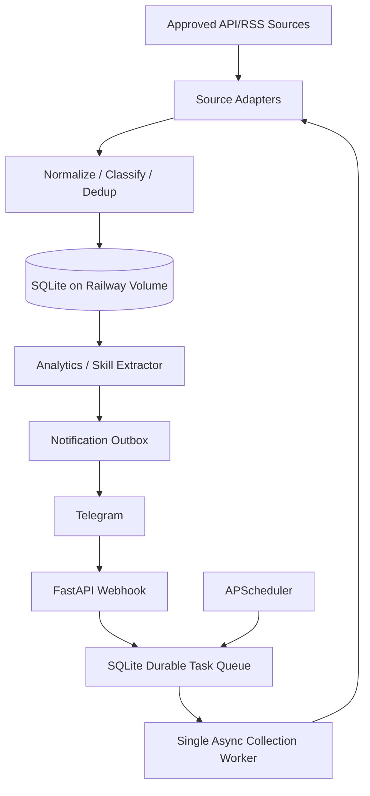

# Architecture — Modular Monolith

## Deployment
One Railway service, one container, one Uvicorn worker, persistent volume mounted at `/data`. Database path `/data/hunter.db`. Only one application instance may run the in-process scheduler/worker; multi-replica is out of scope. Configure health check `/health/live`. Keep Docker image minimal.

## Responsibilities
- `api`: request validation, auth, short webhook handling.
- `sources`: source-specific access and parsing; no DB writes.
- `collection`: scheduling, lease claiming, retries, ingestion orchestration.
- `normalization`: canonical job schema, classification, dedup and content hashes.
- `analytics`: dictionary-based skills and SQL aggregates.
- `notifications`: durable outbox and Telegram delivery.
- `db`: ORM, migrations and transactions.

## Source integration boundary

Every adapter is a read-only boundary from one approved source into the canonical job model. The policy record is part of the adapter contract: access method, authentication, rate limit, minimum poll interval, allowed fields, attribution, retention and takedown behavior must be known before a source row can be enabled.

Current MVP source states:

- Himalayas: approved and implemented; daily refresh, expiry-aware retention and attribution.
- Freelancer.com: priority approval ticket; blocked until express written permission and an approved API scope are recorded.
- Remote OK: priority clarification ticket; feed access is documented, but retention/polling/storage/takedown rules are not complete, so no adapter yet.
- Upwork: pending API approval; no scraping or browser automation.

The normalized mapping is source-specific only at the adapter edge. Adapters emit canonical identifiers, title, description/excerpt, source URL, timestamps, location, budget/currency, source type and skills; they do not submit proposals or mutate source records. A source may provide general employment listings, but classification and notification eligibility remain separate from ingestion. Playwright, if ever approved, runs in an isolated optional adapter; OCR and visual/LLM agents are not MVP components.

## Reliability boundaries
Webhook acknowledges only after queue record commits. Worker leases tasks atomically, heartbeats or uses bounded execution; expired leases are reclaimed. Retry transient failures with exponential backoff and capped attempts; permanent failures move to `failed`. Per-source schedule enforces minimum interval. Use outbox unique `event_key` to avoid duplicate intent; Telegram API may still produce rare duplicates if a send succeeds but acknowledgment is lost. On shutdown stop claiming new work and finish/expire leases safely.

## Scheduling
Source-specific polling; intervals must comply with verified terms. Never assume source publication latency equals poll frequency. Store `published_at`, `first_seen_at`, `notified_at` separately. Daily report time configured with IANA timezone `Europe/Istanbul`; persist all timestamps UTC.

Sprint 2 uses one APScheduler tick with `max_instances=1`. The tick enqueues only approved/enabled sources whose `minimum_poll_seconds` has elapsed, then processes at most one leased task. HTTP/network transient failures use capped exponential backoff and honor numeric `Retry-After`; permanent errors are not retried.

The same scheduler runs the daily report cron and pending notification delivery when Telegram is configured. Delivery recovers stale `sending` events, uses bounded retry delays, and keeps collection polling disabled when `COLLECTION_ENABLED=false`.

## Growth path
v0.2 add detailed analytics and new-job alerts; v0.3 optional embeddings/ranking in isolated short-lived worker; v0.4 human-approved proposals; v0.5 authorized submission adapters. Extract separate compute worker only after actual resource measurements.
